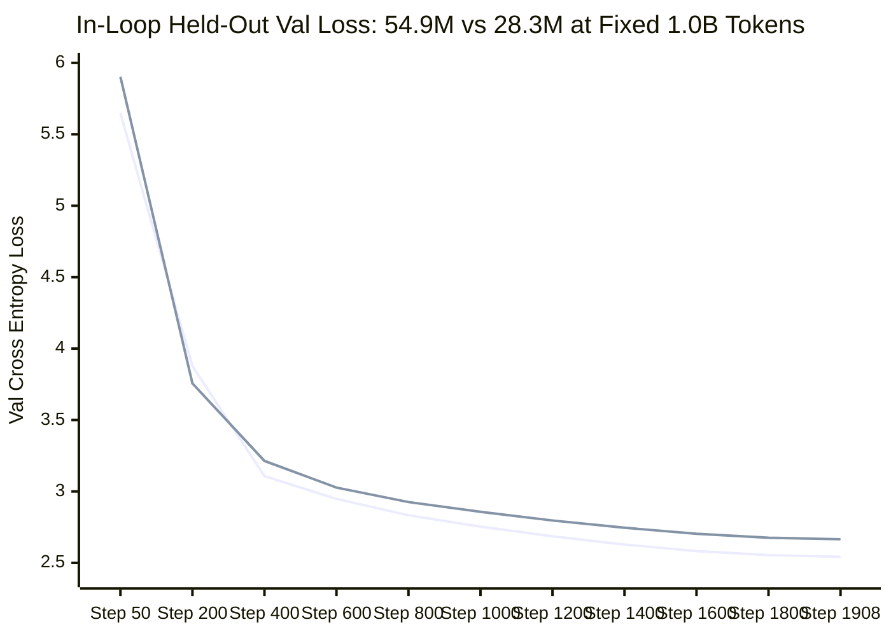

# Vak: Parameter Scaling at a Fixed Token Budget (28.3M → 54.9M)

**Model Architecture:** 54,940,416 parameters | 18 layers | $d_{\text{model}}=512$ | 8 Q-heads, 2 KV-heads (4:1 GQA, head_dim 64) | SwiGLU ($d_{\text{ffn}}=1408$) | QK-Norm | RoPE ($\theta=10000$) | Tied Embeddings | Vocab Size: 8,192 | Context 1,024  
**Hardware Platform:** NVIDIA GeForce RTX 4050 Laptop GPU (6 GB VRAM, Laptop Power Limit: 50W, WSL2)  
**Dual Optimizer:** Quintic Newton-Schulz Muon (2D weight tensors, $\text{lr}=0.02$) + AdamW (1D vectors/Norms/Embeddings, $\text{lr}=0.002$)  
**Total Compute:** 1,908 pretraining steps $\times$ 524,288 tokens/step = **1,000,341,504 tokens** (~8.9 hours effective compute at ~31.1k tok/s)

---

## 1. Executive Summary

This report describes a **controlled parameter-scaling experiment at a fixed token budget**. Holding the corpus, tokenizer, vocabulary, sequence length, optimizer recipe, learning-rate schedule and the 1.0B-token budget *exactly* constant, the model was widened and deepened from **28,326,272** to **54,940,416** parameters ($\times 1.94$). The only independent variable is capacity.

The 28.3M model was heavily over-trained at this budget (**35.3 tokens/parameter**, well past the ~20:1 Chinchilla compute-optimal frontier). The 54.9M model lands at **18.2 tokens/parameter** — essentially on the compute-optimal frontier. The result is a clear, measured quality gain at higher compute cost:

* **Held-Out Pretraining Loss (identical in-loop protocol):** 2.6654 $\to$ **2.5422** nats ($-4.6\%$), perplexity 14.37 $\to$ **12.71** ($\mathbf{-11.6\%}$).
* **Held-Out Validation Loss (`eval.py` protocol, identical 200-document sample):** 2.4570 $\to$ **2.3248** nats, perplexity 11.67 $\to$ **10.22** ($\mathbf{-12.4\%}$).
* **Bits-Per-Byte:** 0.936 $\to$ **0.885 BPB** (3.354 bits/token at 3.79 bytes/token).
* **Zero-Shot Reasoning:** HellaSwag **45.0%**, ARC-Easy **37.0%**, PIQA **59.0%** (acc_norm, 100 samples). Net effect versus the 28.3M model is flat within the $\pm$5 pp standard error of a 100-sample slice.
* **SFT Val Assistant Loss:** **0.1192** after 3 epochs (28.3M: 0.1128) — slightly *worse* at the final epoch despite a much lower training loss (0.0037 vs 0.0194), i.e. mild overfitting to the 2,959-conversation SFT set at higher capacity.
* **Conversational Behaviour:** **100.0% `<|end|>` termination** and **0.0% repetition loop rate** on both 50-prompt tiers, with held-out semantic accuracy **48.0%** (28.3M: 50.0%) — indistinguishable at $n=50$.
* **Throughput:** 31,815 tok/s median (28.3M: 51,471 tok/s), i.e. **$-38\%$ throughput for $1.94\times$ the parameters**; effective compute grew from ~5.5 h to ~8.9 h.

**Verdict:** parameter scaling delivered a solid, honestly-measured $-12\%$ perplexity improvement at fixed data — the expected direction, and above the lower bound of the 5–15% ballpark. It did **not** move the small zero-shot benchmarks or the chat tiers beyond noise, and it slightly *hurt* SFT-set generalisation. The next lever is corpus growth, not more parameters at this token budget.

---

## 2. Controlled Comparison (identical corpus, recipe and 1.0B token budget)

| Evaluation Metric | Phase 1 (28.3M) | **Phase 2 (54.9M)** | Change |
|---|---|---|---|
| **Total Pretrained Tokens** | 1,000,341,504 | **1,000,341,504** | 0 (identical budget) |
| **Parameters** | 28,326,272 | **54,940,416** | $+93.9\%$ |
| **Token-to-Parameter Ratio** | 35.32 tok/param | **18.21 tok/param** | $-48.4\%$ |
| **Pretraining Final Step Loss** | 2.5766 | **2.4459** | $-0.1307$ nats |
| **Pretraining Final Step BPT (bits/tok)** | 3.717 | **3.529** | $-0.188$ bits/tok |
| **In-Loop Val Loss (step 50)** | 5.9028 | **5.6479** | $-0.2549$ nats |
| **In-Loop Val Loss (final, step 1908)** | 2.6654 | **2.5422** | $-0.1232$ nats ($-4.6\%$) |
| **In-Loop Val Perplexity (final)** | 14.37 | **12.71** | $\mathbf{-11.6\%}$ |
| **In-Loop Val BPT (bits/tok)** | 3.845 | **3.668** | $-0.177$ bits/tok |
| **Held-Out Val Loss (`eval.py`)** | 2.4570 | **2.3248** | $-0.1322$ nats |
| **Held-Out Val Perplexity (`eval.py`)** | 11.67 | **10.22** | $\mathbf{-12.4\%}$ |
| **Held-Out Val BPT / BPB** | 3.545 / 0.936 | **3.354 / 0.885** | $-0.191$ BPT / $-0.051$ BPB |
| **HellaSwag (0-shot Acc Norm)** | 44.00% | **45.00%** | $+1.0$ pp |
| **ARC-Easy (0-shot Acc Norm)** | 39.00% | **37.00%** | $-2.0$ pp |
| **PIQA (0-shot Acc Norm)** | 56.00% | **59.00%** | $+3.0$ pp |
| **SFT Val Assistant Loss (epoch 1 / 2 / 3)** | 0.3018 / 0.1519 / **0.1128** | 0.2679 / 0.1441 / **0.1192** | final: $+0.0064$ (worse) |
| **SFT Final Training Batch Loss** | 0.0194 | **0.0037** | $-0.0157$ |
| **In-Template Termination Rate** | 100.0% | **100.0%** | 0.0 pp |
| **In-Template Repetition Rate** | 0.0% | **0.0%** | 0.0 pp |
| **Held-Out Termination Rate** | 100.0% | **100.0%** | 0.0 pp |
| **Held-Out Repetition Rate** | 0.0% | **0.0%** | 0.0 pp |
| **Held-Out Semantic Accuracy** | 50.0% | **48.0%** | $-2.0$ pp (within noise) |
| **Median Throughput** | 51,471 tok/s | **31,815 tok/s** | $-38.2\%$ |
| **Effective Compute** | ~5.5 h | **~8.9 h** | $+1.62\times$ |

*Comparability note: the two "in-loop" rows come from `evaluate_val(max_batches=20)` inside the training loop and use identical deterministic validation batches in both runs, so they are strictly like-for-like. The two "`eval.py`" rows come from a separate fixed 200-document sample (113,087 tokens / 428,342 bytes, verified byte-identical between the runs) and are also directly comparable — but the in-loop and `eval.py` protocols are **not** comparable with each other (different samples and different sequence handling). Metrics within a protocol column may be compared; metrics across protocols may not.*

---

## 3. Data Pipeline & Token Distribution

**The corpus is byte-identical to the Phase-1 run: no re-tokenization, no vocabulary change, no new data.** `data/tokenized/` was last written 2026-10-16 06:35, before the Phase-2 pretraining run started, and still contains the same 118 `uint16` shards:

* **Train:** 106 shards = **1,057,535,818 tokens** (single pass, zero token looping, covering the 1,908 $\times$ 524,288 = 1.0004B budget).
* **Val:** 6 shards = 59,026,719 tokens. **Test:** 6 shards = 59,186,744 tokens.
* **Mixture (unchanged):** FineWeb-Edu 50% / Cosmopedia v2 25% / Python-Edu 12% / OpenWebMath 8% / TinyStories 5%.
* **Tokenizer (unchanged):** 8,192-vocab BPE, `<|bos|>` (0), `<|user|>` (1), `<|assistant|>` (2), `<|end|>` (3).

Because the data, tokenizer and token budget are all held constant, every quality delta in Section 2 is attributable to model capacity alone — not to data distribution.

---

## 4. Pretraining Convergence & Hardware Telemetry



### Key Training Highlights:
1. **The capacity gain is visible early and holds.** The 54.9M model leads at step 50 (5.6479 vs 5.9028) and finishes ahead by $-0.1232$ nats at step 1908. Across all **39 shared evaluation points, 54.9M is ahead at 36 and behind at exactly 2 — steps 200 and 250**, which fall inside the LR re-warm window of a resume (Section 4.4). From step 300 onward the lead is never relinquished. There are no loss spikes, divergence events or gradient-clipping failures.
2. **Throughput and cost:** median **31,815 tok/s** (mean 31,127, min 22,174 on evaluation/checkpoint steps, max 33,285) under `torch.compile` (inductor) with BF16 and PyTorch SDPA, versus 51,471 tok/s for the 28.3M model. Effective compute for the full run was **~8.9 h** ($1.62\times$ the 28.3M run) for $1.94\times$ the parameters — sub-linear cost growth, as expected when the smaller model is latency-bound rather than FLOP-bound.
3. **Thermal & memory stability:** core temperature stayed between **62 °C and 72 °C** (median 68 °C); the torch allocator held **587–807 MB** of the 6,141 MB available. The run's actual GPU footprint including the CUDA context was ~4.4 GB, which is why unrelated GPU work had to be avoided.
4. **Run integrity — disclosed deviation.** The run was executed in **5 segments** (1 cold start + 4 resumes), interrupted by **2 manual stops** and **2 CUDA context losses** (`cudaErrorUnknown`). The context losses were diagnosed as environmental, not a code defect: WSL2 GPU-PV logged `misc dxg: dxgkio_escape: Ioctl failed: -22` around the crash with no Xid, following a Windows hibernation event. Two engineering fixes were applied mid-run and are committed: (a) the resume path held the whole checkpoint resident on the GPU in addition to the model (~220 MB, visible as 807 MB pre-fix vs 587 MB post-fix), and (b) a bounded auto-restart wrapper (`scripts/run_pretrain_resilient.sh`) resumes unattended after a transient GPU fault.
   *Consequence for interpretation:* each resume re-warms the LR over **100 steps** (`resume_rewarm_steps`). With 4 resumes, **400 of 1,908 steps (~21%)** were trained at re-warmed (depressed) LR. The final loss is therefore, if anything, a slight *under*-estimate of what a single uninterrupted run would have produced.
5. **Checkpointing:** every 100 steps plus a 15-minute wall-clock save, 40 checkpoints retained in `checkpoints/run_55m/`. `pretrain_latest.pt` is step 1908.

---

## 5. Zero-Shot Benchmarking (Base Foundation Model)

Prior to SFT, the raw base model was evaluated with `lm-evaluation-harness` on the identical Phase-1 protocol (100 samples per task, 0-shot):

| Task | Domain | Metric | Phase 1 (28.3M) | **Phase 2 (54.9M)** | Random Chance |
|---|---|---|---|---|---|
| **HellaSwag** | Commonsense Continuation | Accuracy / Acc Norm | 36.00% / 44.00% | **37.00% / 45.00%** | 25.00% |
| **ARC-Easy** | Grade-School Science Reasoning | Accuracy / Acc Norm | 38.00% / 39.00% | **40.00% / 37.00%** | 25.00% |
| **PIQA** | Physical Intuition Reasoning | Accuracy / Acc Norm | 58.00% / 56.00% | **59.00% / 59.00%** | 50.00% |

**Honest read:** the aggregate benchmark movement is **flat** (+1, −2, +3 pp) and entirely inside the $\pm$5 pp standard error of a 100-sample slice (per-task stderr is ~4.9 pp — see `reports/lmeval_pretrain_55m_base.json`). Doubling capacity at a fixed 1.0B-token budget does **not** buy measurable zero-shot benchmark gains on this hardware/budget; the held-out perplexity improvement (−12.4%) is the sensitive signal, and it is consistent across two independent protocols and 39 checkpoints. No regression was observed, but no benchmark claim is supported either.

---

## 6. Supervised Fine-Tuning (SFT)

Identical recipe to Phase 1: 3 epochs, AdamW ($\text{lr}=2\times10^{-4}$, cosine decay to $2\times10^{-5}$), gradient clipping at 1.0, loss computed **strictly on assistant tokens** (`ignore_index=-100`), batch size 8, context 1,024. Base weights loaded from `checkpoints/run_55m/pretrain_latest.pt` (step 1908).

* **Training corpus:** 2,959 multi-turn dialogues (`data/processed/sft_train.jsonl`), 370 batches/epoch.
* **Validation corpus:** 510 held-out dialogues (`data/processed/sft_val.jsonl`), 64 batches.

| Epoch | Phase 1 Val Loss (28.3M) | **Phase 2 Val Loss (54.9M)** | Phase 1 Val Ppl | **Phase 2 Val Ppl** |
|---|---|---|---|---|
| 1 | 0.3018 | **0.2679** | 1.35 | **1.31** |
| 2 | 0.1519 | **0.1441** | 1.16 | **1.15** |
| 3 | **0.1128** | 0.1192 | 1.12 | 1.13 |

**Honest read:** epochs 1 and 2 improved, but the final epoch is marginally *worse* than the 28.3M model (0.1192 vs 0.1128, perplexity 1.13 vs 1.12). Meanwhile the training loss collapsed much further (final batch 0.0037 vs 0.0194). That combination — lower training loss, higher validation loss — is the signature of **mild overfitting to the small 2,959-conversation SFT set at higher model capacity**. With 3 epochs on this much data, the 54.9M model has enough capacity to memorise dialogue-specific surface patterns. The practical implication: the SFT set, not the model, is now the binding constraint on alignment quality.

---

## 7. Conversational Evaluation

The SFT model was evaluated with the same fixed 100-prompt harness used in Phase 1: **50 in-template recall prompts** (templates seen during training) and **50 held-out prompts** across six categories (greeting, identity, fact, arithmetic, sequence, reasoning), each graded for `<|end|>` termination, degenerate repetition, and — for the held-out tier — semantic correctness against expected keywords. Generation is sampled (temperature 0.5, top-k 40, top-p 0.9, repetition penalty 1.15, max 256 new tokens), so these are **stochastic** metrics on $n=50$; the standard error is ~7 pp.

| Metric | Phase 1 (28.3M) | **Phase 2 (54.9M)** |
|---|---|---|
| In-template termination / repetition | 100.0% / 0.0% | **100.0% / 0.0%** |
| Held-out termination / repetition | 100.0% / 0.0% | **100.0% / 0.0%** |
| Held-out semantic accuracy | 50.0% (25/50) | **48.0% (24/50)** |

Both correctness gates from the plan are met (**≥95% termination, <5% degenerate loops**) with margin, at 100% / 0%. The 2 pp difference in held-out semantic accuracy is far inside the noise floor.

### Live smoke test (verbatim, 54.9M SFT model)

```
User: Hello!
Vak: Hi there! How can I help you today?

User: What is your name?
Vak: My name is Vak.

User: Count from 1 to 10
Vak: 1, 2, 3, 4, 5, 6, 7, 8, 9, 10.

User: What is the capital of France?
Vak: The capital of France is Paris.

User: What do bees make?
Vak: Bees make honey.

User: Tell me a short story.
Vak: Once upon a time, a curious bird found a shiny golden key beneath a tall oak tree. When it unlocked the garden gate, all the flowers bloomed with vibrant colors.
```

*Note on comparability: this smoke test uses a slightly different prompt set from the Phase-1 report's table ("Count from 1 to 10" vs "Count from 1 to 5.", "Tell me a short story." vs "Tell me a short story about a puppy."), so the two are not a like-for-like diff. The responses above are recorded verbatim from `scripts/chat.py` against `checkpoints/run_55m/vak_chat_sft.pt`.*

**One honest negative finding:** the SFT model's general language-modeling ability degraded *more* than the 28.3M model's. Evaluating the SFT checkpoint on the held-out pretraining text sample gives perplexity **352.8** for the 54.9M model versus **185.2** for the 28.3M model. Fine-tuning on 2,959 conversations costs more general capability at higher capacity — the same overfitting signal as Section 6, and the second reason the SFT corpus is now the binding constraint.

---

## 8. Honest Assessment & Limitations

1. **The win is real but bounded to the language-modeling objective.** A $1.94\times$ capacity increase at fixed data bought a consistent $-12\%$ perplexity. The zero-shot benchmarks and the chat tiers did not move beyond noise, and the SFT validation loss slightly regressed.
2. **Capacity is still tiny.** At 54.9M parameters the model reliably recalls common facts and short instructions (see Section 7), but it cannot store broad encyclopedic knowledge; esoteric queries still degrade to generic or repetitive text. Arithmetic depth remains limited to simple single-step operations and counting.
3. **Statistical honesty on generation metrics.** The chat tiers are 50-prompt samples and the benchmarks are 100-sample slices; at $n=50$–100 the standard error is ~5–7 pp. Differences of a few points between Phase 1 and Phase 2 in those rows are **not** significant. Only the loss/perplexity metrics, measured over 113,087 tokens and 39 checkpoints, support quantitative claims.
4. **The pretraining curve is slightly non-standard.** ~21% of steps were trained at re-warmed LR because of the 4 environmental interruptions (Section 4.4). This depresses the final loss rather than flattering it.
5. **The data budget, not the model, is now the bottleneck.** 18.2 tokens/parameter is on the compute-optimal frontier: adding parameters at a fixed 1.0B tokens is no longer the efficient lever. Corpus growth past 1.0B tokens is the natural next experiment and is explicitly out of scope for this phase.
6. **No architecture changes were made.** MoE, alternative attention, untied embeddings and context extension all remain untested; nothing in this report speaks to them.

---

## 9. Reproducibility & Artifact Traceability

Every number above is traceable to a checked-in artifact:

| Claim | Artifact |
|---|---|
| Parameter count (54,940,416), 18 layers | `configs/config.yaml`, `checkpoints/run_55m/pretrain_step_001908.pt` |
| In-loop val loss / throughput / temperature | `logs/pretrain_55m.log` (39 eval lines, 195 step lines) |
| Held-out val loss, BPT, BPB (`eval.py`) | `reports/eval_pretrain_55m_base.json` |
| Zero-shot benchmarks | `reports/lmeval_pretrain_55m_base.json` |
| SFT per-epoch val loss | `logs/sft_55m.log`, `checkpoints/run_55m/vak_chat_sft.pt` |
| Chat tiers + samples | `reports/eval_results_55m.json` |
| Phase-1 baseline for all comparisons | `logs/pretrain_1b.log`, `reports/eval_pretrain_1b_base.json`, `reports/lmeval_pretrain_1b_base.json`, `reports/eval_results.json` |

```bash
# Launch interactive Chat CLI with the 54.9M SFT model
PYTHONPATH=. venv/bin/python scripts/chat.py --checkpoint checkpoints/run_55m/vak_chat_sft.pt

# Full automated validation & chat evaluation
PYTHONPATH=. venv/bin/python scripts/eval.py --checkpoint checkpoints/run_55m/vak_chat_sft.pt \
    --output reports/eval_results_55m.json

# Zero-shot lm-evaluation-harness on the base model
PYTHONPATH=. venv/bin/python scripts/benchmark_lmeval.py \
    --checkpoint checkpoints/run_55m/pretrain_step_001908.pt --tasks hellaswag,arc_easy,piqa --limit 100
```

**Artifact isolation:** no Phase-2 artifact overwrites a Phase-1 artifact. The Phase-1 28.3M checkpoints remain at the top level of `checkpoints/`; all Phase-2 outputs live under `checkpoints/run_55m/` and carry the `_55m` suffix in `reports/`.
